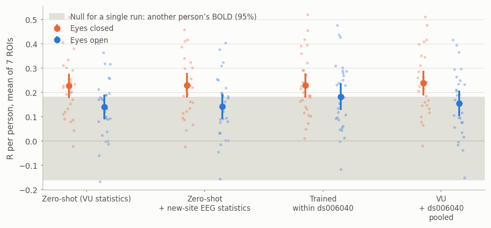
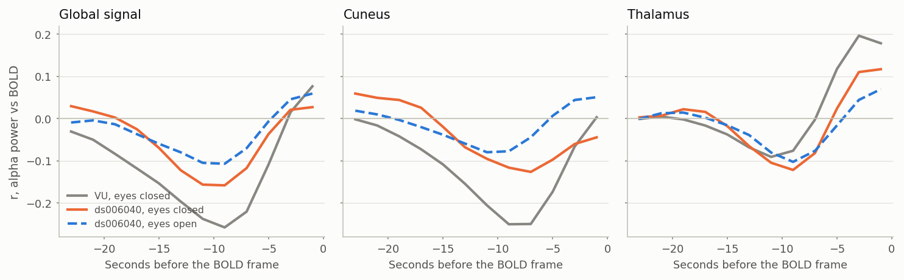
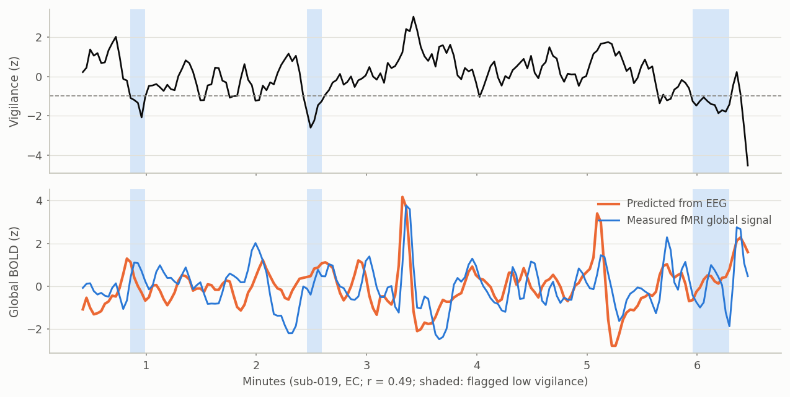
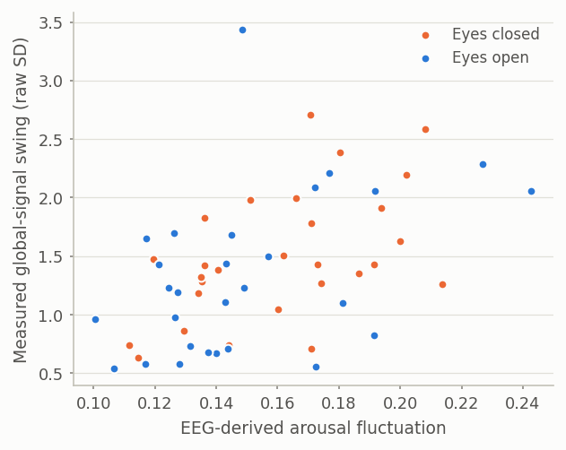

# External validation on ds006040, and the EEG arousal monitor

Seamus Taylor · 19 October 2026 · models trained on the VU data (22 people), tested on OpenNeuro ds006040 (28 people) · Monash M3

Everything in the interpretability round came from one site. This round asks whether it survives a different site, scanner, EEG cap, artefact-cleaning pipeline and eye state, and turns the main finding into a working tool.

## Bottom line

- **The VU model transfers with no site penalty.** Frozen and applied to 28 new people at another site, ridge predicts eyes-closed BOLD at R = 0.227 (7 ROIs), the same as a model trained inside ds006040 itself (0.228; paired Δ 0.000, 95% CI −0.018 to +0.018). Pooling both sites adds +0.010 (not significant).
- **The level is lower than on VU (0.23 against 0.38) because of the data, not the transfer.** Runs are 6 minutes instead of 20, and a model trained on ds006040 does no better. Short, alert recordings carry less arousal fluctuation to predict.
- **Region-specific signal transfers too.** After global-signal regression, the frozen model reaches 0.106 against 0.119 trained in-domain, and pooling lifts it to 0.132.
- **Eye state is a real shift.** On eyes-open rest the frozen model drops to 0.14, while training on eyes-open data reaches 0.18 (eyes closed minus eyes open: +0.087, 95% CI +0.029 to +0.144).
- **Ridge still beats NeuroBOLT.** The authors' published checkpoints reach 0.18 on the new eyes-closed runs, 0.05 below ridge (95% CI −0.068 to −0.029); on eyes-open runs they tie.
- **The coupling signatures replicate in direction and timing, at about 60% of the strength:** cortical and global alpha couple negatively about 9–11 s before the frame, and the thalamus keeps its positive short-lag lobe.
- **The prototype works on the new site, live.** The EEG arousal monitor tracks the measured global BOLD at r = 0.26 on eyes-closed runs (0.17 eyes open), equally well in streaming mode, at about 3 ms of computation per fMRI volume. Its run-level arousal-fluctuation score tracks the global-signal swing fMRI actually measured (Spearman ρ = +0.50 across 56 runs, p < 0.001).

## The new dataset

- **ds006040** (Cha et al., Scientific Data 2026; OpenNeuro, CC0): 28 people at Sungkyunkwan University, 3T Siemens Prisma, TR 2.0 s, 64-channel BrainCap MR EEG at 5 kHz.
- **Runs used:** eyes-closed (EC) and eyes-open (EO) rest with the scanner on, about 6.3 minutes each (190 volumes), one of each per person: 56 runs.
- **Differences from VU:** another site and scanner, a different cap and gradient/BCG-correction pipeline (the authors' FMRIB and median-template removal), runs a third as long (6 against 20 minutes), TR 2.0 against 2.1 s, and an eyes-open condition the models never saw.
- **Preprocessing as close to VU as the data allow** (`scripts/ext_build_ds006040.py`): the same 26 EEG channels, 200 Hz, 0.5 Hz high-pass, 24 s windows ending at each volume's marker, log power in 44 one-Hz bins × 12 lags; targets are DiFuMo-64 regions and the brain-mask mean from fMRIPrep's MNI-space BOLD after regressing 24 motion parameters, then VU's 0.15 Hz low-pass and scaling.
- **Missing EEG:** 9 of 56 runs contain stretches with no EEG (all channels NaN, e.g. the first 30 s of sub-007's eyes-closed run). Frames whose window touches a gap (with a 5 s margin) are dropped.

## Transfer protocols

| Protocol | What it tests |
| --- | --- |
| Zero-shot | Ridge fitted on all 29 VU scans, applied unchanged; ds006040 features standardised with VU statistics |
| Zero-shot + new-site EEG statistics | The same model, features standardised with ds006040's own EEG mean and SD: uses no fMRI from the new site |
| Trained within ds006040 | 5-fold subject-grouped CV inside ds006040: an in-domain reference |
| VU + ds006040 pooled | VU plus the ds006040 training folds, each site standardised with its own statistics |

## Transfer results

Mean R per person (7 ROIs), with 95% CI over the 28 people. Grey: the 95% range of the null for a single run (one person's prediction scored against another person's BOLD); the null mean is +0.00 (SD 0.09), so a group mean is significant far below the band's top. 20 of 28 eyes-closed runs and 14 of 28 eyes-open runs beat their own single-run null.

| Full model (26 channels × 44 bins × 12 lags) | Eyes closed, 7 ROIs | Eyes open, 7 ROIs | Eyes closed, 65 targets | Eyes closed, 64 regions after GSR |
| --- | --- | --- | --- | --- |
| Zero-shot (VU statistics) | 0.227 (0.177 to 0.277) | 0.140 (0.089 to 0.191) | 0.193 | 0.106 |
| Zero-shot + new-site EEG statistics | 0.228 (0.177 to 0.279) | 0.142 (0.091 to 0.192) | 0.194 | 0.110 |
| Trained within ds006040 (5-fold) | 0.228 (0.178 to 0.278) | 0.182 (0.127 to 0.237) | 0.198 | 0.119 |
| VU + ds006040 pooled | 0.238 (0.188 to 0.288) | 0.155 (0.102 to 0.208) | 0.205 | 0.132 |
| Five band powers (60 features), zero-shot | 0.217 | 0.140 | 0.186 | 0.094 |
| Vigilance index (12 features), zero-shot | 0.153 | 0.045 | 0.143 | 0.089 |

- **No site penalty.** Training on the new site's own people gives the same eyes-closed accuracy as importing the VU model. Standardising features with the new site's EEG statistics changes nothing (+0.002), so feature levels were already comparable for ridge.
- **Per region (eyes closed, transferred):** Heschl's gyrus 0.28, thalamus 0.26, global signal 0.25, cuneus 0.25; frontal and parietal association cortex lowest (0.09–0.11), the same ordering as on VU.
- **Eyes open:** the vigilance index nearly stops working (0.045), as expected when alpha is suppressed by open eyes; the full model keeps 0.14 from other spectral features, and training on eyes-open data recovers 0.18.

## Does NeuroBOLT transfer?

| Zero-shot on ds006040 (7 ROIs, same frames) | Eyes closed | Δ vs ridge (95% CI) | Eyes open | Δ vs ridge |
| --- | --- | --- | --- | --- |
| NeuroBOLT, our reproduction | 0.191 | −0.037 (−0.056 to −0.019) | 0.153 | +0.011 (−0.012 to +0.034) |
| NeuroBOLT, authors' published checkpoints | 0.180 | −0.049 (−0.068 to −0.029) | 0.140 | −0.002 (−0.024 to +0.021) |

Input rescaled per channel to the VU amplitude (no fMRI needed); raw input gives the same picture (0.18–0.19). The deep model's disadvantage on eyes-closed data carries over to a new site.

## Do the coupling signatures replicate?

| Target, band | VU (eyes closed) | ds006040 eyes closed | ds006040 eyes open |
| --- | --- | --- | --- |
| Global signal, alpha | −0.26 at 9 s | −0.16 at 9 s | −0.11 at 9 s |
| Cuneus, alpha | −0.25 at 9 s | −0.13 at 7 s | −0.08 at 11 s |
| Thalamus, beta | +0.24 at 3 s | +0.16 at 3 s | −0.10 at 9 s |
| Thalamus, alpha (short-lag lobe) | +0.20 at 3 s | +0.11 at 1–3 s | +0.07 at 1 s |

- The cortical inverse coupling and its 9 s delay replicate, at about 60% of the VU strength.
- The thalamus keeps its positive short-lag lobe for beta and, more weakly, alpha; in ds006040 its negative lobe at 9 s is stronger than on VU, so its strongest alpha coupling is negative there. The thalamic sign flip is the least robust signature and needs a larger sample.

## The EEG arousal monitor on ds006040

The prototype (`app/arousal_monitor`, interactive demo: [EEG Arousal Monitor](https://claude.ai/artifact/M3MtScwGda3GP4d2e27dUU)) applies the frozen VU ridge model to each recording, standardising features within the recording so no fMRI is needed. Streaming mode replays the EEG in 2 s chunks with a causal high-pass and running statistics, exactly as it would run during a scan.

| Tracking the measured global BOLD (56 runs) | Eyes closed | Eyes open |
| --- | --- | --- |
| Offline, r (95% CI over people) | 0.255 (0.198 to 0.311) | 0.171 (0.106 to 0.236) |
| Streaming (causal, running statistics) | 0.263 (0.205 to 0.321) | 0.161 (0.097 to 0.225) |
| Agreement between streaming and offline predictions | 0.93 | 0.96 |
| Compute per fMRI volume (one CPU core) | 3 ms | 3 ms |

| QC score across 56 runs (Spearman ρ) | vs measured global-signal swing | vs how predictable the run is | vs head motion (mean FD) |
| --- | --- | --- | --- |
| Arousal fluctuation (SD of the predicted global BOLD) | +0.50 (p < 0.001) | +0.42 (p = 0.001) | +0.32 (p = 0.017) |
| Vigilance-index fluctuation | −0.04 (p = 0.77) | −0.04 (p = 0.77) | +0.05 (p = 0.72) |

- **What is validated.** The per-volume estimate of brain-wide, arousal-driven BOLD (against fMRI), the live mode (it matches offline), and the run-level arousal-fluctuation score as a QC measure: runs where the monitor sees more arousal movement are runs whose fMRI global signal swings more, and whose BOLD is more predictable.
- **What is not yet validated.** The low-vigilance flags. The raw vigilance index's fluctuation tracks none of the fMRI measures, and ds006040 has no eye tracking or sleep scoring to check flags against. The model-based score is the one to use.
- **Head motion.** The QC score also tracks head motion (ρ = +0.32), which fits arousal and movement rising together; a motion-matched analysis is needed before claiming the score is motion-independent.
- **Not for** clinical use, regional mapping, or eyes-open data without its own calibration.

## Methods and code

- `scripts/ext_fetch_openneuro.py`: resumable download of selected files from OpenNeuro's public bucket (32.4 GB for the rest runs).
- `scripts/ext_build_ds006040.py`: features and targets per run, in VU format.
- `scripts/ext_transfer.py`: transfer protocols, mismatched-person null, coupling replication; exports the frozen VU models (`vu_model_full.npz`, `vu_model_bands60.npz`).
- `scripts/ext_eval_monitor.py`: runs the arousal monitor offline and in streaming mode on every run.
- `scripts/ext_report.py` and `scripts/refresh_ext_report.sh`: tables and figures; `scripts/build_monitor_demo.py`: the demo page.
- `app/arousal_monitor`: the prototype (see `app/README.md`).
