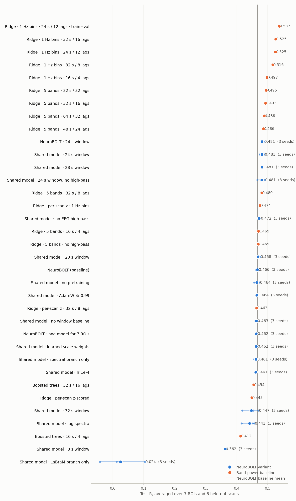

# NeuroBOLT hypothesis tests

*Updated 12 Oct 2026, 21:27 AEDT. Done: 20 NeuroBOLT arms, intra-scan transfer, 19 band-power variants. Running: BatchNorm on NeuroBOLT's LaBraM branch, with both branches and with the LaBraM branch alone.*

Inter-subject prediction on the authors' split (18 training, 5 validation and 6 held-out scans). NeuroBOLT arms train every ROI with three seeds (12345, 1, 2); band-power baselines are deterministic. Every run is scored at its validation-selected point on the frames all arms share. Test R is averaged over the six held-out scans and, for NeuroBOLT, the seeds.

| Arm | Seeds | Cuneus | Heschl's | Mid. frontal | Precuneus | Putamen | Thalamus | Global | Avg. test R | Avg. val R | Δ test vs reference (95% CI) | Δ val |
|---|---|---|---|---|---|---|---|---|---|---|---|---|
| Ridge · 1 Hz bins · 24 s / 12 lags · train+val | 1 | 0.533 | 0.613 | 0.521 | 0.580 | 0.422 | 0.476 | 0.614 | 0.537 | 0.385 | +0.071 (+0.042 to +0.099) | +0.060 |
| Ridge · 1 Hz bins · 32 s / 16 lags | 1 | 0.538 | 0.609 | 0.498 | 0.567 | 0.395 | 0.472 | 0.597 | 0.525 | 0.371 | +0.059 (+0.023 to +0.095) | +0.046 |
| Ridge · 1 Hz bins · 24 s / 12 lags | 1 | 0.534 | 0.606 | 0.510 | 0.566 | 0.402 | 0.458 | 0.597 | 0.525 | 0.385 | +0.058 (+0.034 to +0.082) | +0.060 |
| Ridge · 1 Hz bins · 32 s / 8 lags | 1 | 0.528 | 0.602 | 0.493 | 0.559 | 0.390 | 0.451 | 0.587 | 0.516 | 0.365 | +0.049 (+0.018 to +0.081) | +0.040 |
| Ridge · 1 Hz bins · 16 s / 4 lags | 1 | 0.503 | 0.572 | 0.475 | 0.536 | 0.373 | 0.450 | 0.570 | 0.497 | 0.374 | +0.031 (+0.020 to +0.041) | +0.049 |
| Ridge · 5 bands · 32 s / 32 lags | 1 | 0.537 | 0.568 | 0.460 | 0.532 | 0.350 | 0.458 | 0.557 | 0.495 | 0.316 | +0.028 (-0.006 to +0.062) | -0.009 |
| Ridge · 5 bands · 32 s / 16 lags | 1 | 0.523 | 0.572 | 0.462 | 0.527 | 0.352 | 0.455 | 0.556 | 0.493 | 0.344 | +0.026 (+0.001 to +0.052) | +0.019 |
| Ridge · 5 bands · 64 s / 32 lags | 1 | 0.525 | 0.575 | 0.447 | 0.530 | 0.350 | 0.440 | 0.552 | 0.488 | 0.338 | +0.022 (-0.008 to +0.052) | +0.013 |
| Ridge · 5 bands · 48 s / 24 lags | 1 | 0.524 | 0.567 | 0.445 | 0.524 | 0.347 | 0.447 | 0.545 | 0.486 | 0.339 | +0.019 (-0.008 to +0.047) | +0.014 |
| NeuroBOLT · 24 s window | 3 | 0.490 | 0.509 | 0.448 | 0.527 | 0.366 | 0.449 | 0.580 | 0.481 | 0.338 | +0.015 (-0.004 to +0.034) | +0.013 |
| Shared model · 24 s window | 3 | 0.474 | 0.542 | 0.474 | 0.529 | 0.368 | 0.407 | 0.575 | 0.481 | 0.340 | +0.019 (-0.005 to +0.042) | +0.009 |
| Shared model · 28 s window | 3 | 0.479 | 0.550 | 0.472 | 0.525 | 0.375 | 0.396 | 0.571 | 0.481 | 0.304 | +0.018 (-0.009 to +0.046) | -0.028 |
| Shared model · 24 s window, no high-pass | 3 | 0.470 | 0.548 | 0.474 | 0.527 | 0.358 | 0.418 | 0.569 | 0.481 | 0.335 | +0.018 (-0.006 to +0.042) | +0.004 |
| Ridge · 5 bands · 32 s / 8 lags | 1 | 0.511 | 0.558 | 0.451 | 0.515 | 0.341 | 0.447 | 0.539 | 0.480 | 0.338 | +0.014 (-0.002 to +0.031) | +0.013 |
| Ridge · per-scan z · 1 Hz bins | 1 | 0.473 | 0.553 | 0.462 | 0.491 | 0.358 | 0.451 | 0.533 | 0.474 | 0.379 | +0.008 (-0.008 to +0.024) | +0.054 |
| Shared model · no EEG high-pass | 3 | 0.454 | 0.519 | 0.458 | 0.520 | 0.347 | 0.448 | 0.556 | 0.472 | 0.330 | +0.009 (-0.006 to +0.025) | -0.002 |
| Ridge · 5 bands · 16 s / 4 lags | 1 | 0.470 | 0.536 | 0.445 | 0.506 | 0.327 | 0.456 | 0.546 | 0.469 | 0.337 | +0.003 (-0.016 to +0.022) | +0.012 |
| Ridge · 5 bands · no high-pass | 1 | 0.469 | 0.535 | 0.445 | 0.507 | 0.327 | 0.456 | 0.546 | 0.469 | 0.336 | +0.003 (-0.015 to +0.022) | +0.011 |
| Shared model · 20 s window | 3 | 0.442 | 0.514 | 0.457 | 0.518 | 0.367 | 0.418 | 0.562 | 0.468 | 0.341 | +0.006 (-0.014 to +0.026) | +0.010 |
| NeuroBOLT (baseline) | 3 | 0.468 | 0.520 | 0.436 | 0.502 | 0.327 | 0.460 | 0.551 | 0.466 | 0.325 | reference |  |
| Shared model · no pretraining | 3 | 0.452 | 0.511 | 0.445 | 0.509 | 0.341 | 0.446 | 0.546 | 0.464 | 0.320 | +0.002 (-0.011 to +0.015) | -0.012 |
| Shared model · AdamW β₂ 0.99 | 3 | 0.449 | 0.503 | 0.450 | 0.506 | 0.350 | 0.448 | 0.544 | 0.464 | 0.332 | +0.002 (-0.001 to +0.004) | +0.000 |
| Ridge · per-scan z · 32 s / 8 lags | 1 | 0.481 | 0.545 | 0.441 | 0.505 | 0.336 | 0.424 | 0.511 | 0.463 | 0.342 | -0.003 (-0.021 to +0.016) | +0.017 |
| Shared model · no window baseline | 3 | 0.443 | 0.501 | 0.449 | 0.507 | 0.351 | 0.446 | 0.543 | 0.463 | 0.332 | +0.000 (-0.000 to +0.001) | +0.000 |
| NeuroBOLT · one model for 7 ROIs | 3 | 0.443 | 0.501 | 0.449 | 0.507 | 0.351 | 0.445 | 0.543 | 0.462 | 0.332 | -0.004 (-0.024 to +0.017) | +0.007 |
| Shared model · learned scale weights | 3 | 0.442 | 0.500 | 0.449 | 0.506 | 0.351 | 0.445 | 0.542 | 0.462 | 0.331 | -0.000 (-0.001 to +0.000) | -0.001 |
| Shared model · spectral branch only | 3 | 0.450 | 0.501 | 0.445 | 0.502 | 0.349 | 0.446 | 0.536 | 0.461 | 0.331 | -0.001 (-0.014 to +0.012) | -0.001 |
| Shared model · lr 1e-4 | 3 | 0.442 | 0.497 | 0.447 | 0.508 | 0.350 | 0.437 | 0.544 | 0.461 | 0.340 | -0.002 (-0.013 to +0.009) | +0.008 |
| Boosted trees · 32 s / 16 lags | 1 | 0.501 | 0.527 | 0.430 | 0.532 | 0.257 | 0.378 | 0.552 | 0.454 | 0.306 | -0.012 (-0.073 to +0.048) | -0.019 |
| Ridge · per-scan z-scored | 1 | 0.450 | 0.517 | 0.434 | 0.477 | 0.312 | 0.451 | 0.498 | 0.448 | 0.337 | -0.018 (-0.041 to +0.005) | +0.012 |
| Shared model · 32 s window | 3 | 0.476 | 0.512 | 0.436 | 0.503 | 0.333 | 0.317 | 0.551 | 0.447 | 0.310 | -0.016 (-0.047 to +0.016) | -0.022 |
| Shared model · log spectra | 3 | 0.404 | 0.485 | 0.439 | 0.489 | 0.337 | 0.420 | 0.516 | 0.441 | 0.337 | -0.021 (-0.046 to +0.003) | +0.006 |
| Boosted trees · 16 s / 4 lags | 1 | 0.442 | 0.507 | 0.376 | 0.472 | 0.176 | 0.383 | 0.527 | 0.412 | 0.282 | -0.054 (-0.128 to +0.019) | -0.043 |
| Shared model · 8 s window | 3 | 0.354 | 0.414 | 0.330 | 0.378 | 0.277 | 0.378 | 0.404 | 0.362 | 0.243 | -0.100 (-0.130 to -0.071) | -0.088 |
| Shared model · LaBraM branch only | 3 | 0.070 | 0.103 | -0.007 | 0.003 | -0.044 | 0.021 | 0.027 | 0.024 | 0.030 | -0.438 (-0.484 to -0.392) | -0.302 |
| NeuroBOLT · 32 s window | 1 | 0.473 | 0.482 | 0.445 | – | – | – | – | – | – | – | – |

Δ is paired by ROI and held-out scan, against the per-ROI NeuroBOLT baseline (shared-model arms: against the shared 7-ROI baseline); its 95% CI is a t-interval over the six held-out scans. Rows with a dash in any ROI are still running.

## Findings so far

### The best predictor so far is linear

- Ridge regression on log EEG power in 1 Hz bins (1–45 Hz), over 32 s of history in sixteen 2 s lag bins, scores 0.525 on the held-out scans and 0.371 on validation. NeuroBOLT scores 0.466 (0.475 when its three seeds are averaged), and the paper reports 0.473.
- The gain comes from two things NeuroBOLT does not exploit across people. 1 Hz bins alone take ridge from 0.469 to 0.497, and 32 s of history alone takes it to 0.493. Going to 48 s or 64 s adds nothing (0.486 and 0.488), so the useful history matches the slow tail of the haemodynamic response.
- With the same 16 s window and five classic bands, ridge already matches NeuroBOLT (0.469 against 0.466 on test, 0.337 against 0.335 on validation). The transformer's extra capacity buys nothing measurable across people.

### For NeuroBOLT, only the window length matters

- A 24 s window (pretrained time embedding stretched from 16 to 24 slots) raises per-region NeuroBOLT from 0.466 to 0.481 on the held-out scans and from 0.325 to 0.338 on validation, with all three seeds better. The 95% interval over the six held-out scans runs from −0.004 to +0.034.
- One shared model with seven outputs scores 0.462, against 0.466 for seven separate models, at a seventh of the training cost. The changes below therefore ran on the shared model and are compared with it.
- Shortening the window to 8 s costs 0.10, and lengthening it to 24 s gains 0.019, so EEG history is the one setting that matters. Six other changes move the score by 0.009 or less in either direction. Log-compressing the spectral branch's input, the change that band-power ridge suggested, hurts on the held-out scans.
- Unlike ridge, NeuroBOLT does not keep improving with more history. A 32 s window drops the shared model to 0.447, below even the 16 s baseline, and the per-region 32 s runs that finished trail their 24 s counterparts. Stretching LaBraM's 16 pretrained time slots twofold may distort them, and 833 tokens per window is a lot to fit from 13 people. The per-region 32 s arm was stopped there, and 20 s and 28 s windows are running to pin down the optimum.
- Dropping the high-pass on top of the 24 s window adds nothing (0.481 either way).

| Shared 7-region NeuroBOLT, 3 seeds | Δ test R | Δ validation R | Seeds better (test) |
|---|---|---|---|
| 20 s window | +0.006 | +0.010 | 2 of 3 |
| 24 s window | **+0.019** | +0.009 | 3 of 3 |
| 24 s window, no EEG high-pass | +0.018 | +0.004 | 3 of 3 |
| 28 s window | +0.018 | −0.028 | 3 of 3 |
| 32 s window | −0.016 | −0.022 | 1 of 3 |
| No EEG high-pass | +0.009 | −0.002 | 3 of 3 |
| AdamW β₂ 0.99 (paper's Table 5) | +0.002 | +0.000 | 2 of 3 |
| No window baseline correction | +0.000 | +0.000 | 3 of 3 |
| Learned scale weights | −0.000 | −0.001 | 1 of 3 |
| Learning rate 1e-4 | −0.002 | +0.008 | 1 of 3 |
| Log-compressed spectra | −0.021 | +0.006 | 0 of 3 |
| 8 s window | **−0.100** | −0.088 | 0 of 3 |

- The window optimum is 24 s: 20 s gains less, and 28 s matches 24 s on the held-out scans but loses 0.028 on validation.

### All of NeuroBOLT's skill comes from its spectral branch

- With the LaBraM temporal branch removed, the shared model scores 0.461, the same as the full model (0.462). With only the temporal branch it scores 0.024: it never learns at all, and its training correlation stays at 0.00 for every epoch. Training from scratch, without LaBraM's pretrained weights, also changes nothing (0.464).
- The reason is scale. In the authors' trained Thalamus model, the LaBraM branch's pooled embedding varies between windows by only 2% of its size, against 91% for the spectral branch. Averaging 416 tokens and then applying LayerNorm leaves an almost constant vector. Its small variations do carry information (ridge on them predicts the thalamus at R = 0.42 within a scan, against 0.62 for the spectral features), but the prediction head cannot use them at that scale.
- Running now: the same model with a BatchNorm on the LaBraM embedding, which rescales its window-to-window variation. In a short local check, the temporal branch on its own then learns.

| Shared 7-region NeuroBOLT, 3 seeds | Test R | Δ test R | Δ validation R |
|---|---|---|---|
| Both branches (shared baseline) | 0.462 | | |
| Spectral branch only | 0.461 | −0.001 | −0.001 |
| No LaBraM pretraining | 0.464 | +0.002 | −0.012 |
| **LaBraM temporal branch only** | **0.024** | **−0.438** | **−0.302** |

### More people help

- Refitting the best ridge on the training and validation scans together (17 people instead of 13), with the penalty still chosen on validation, raises it from 0.525 to 0.537 on the held-out scans. With 13 training people, data is a real limit.

### Ensembles: NeuroBOLT adds little to the best ridge

| Predictions averaged (z-scored per scan) | Validation R | Test R |
|---|---|---|
| NeuroBOLT, 3 seeds | 0.335 | 0.475 |
| Ridge, 1 Hz bins, 32 s / 16 lags | 0.371 | **0.525** |
| NeuroBOLT + that ridge | **0.381** | 0.524 |
| NeuroBOLT + ridge 1 Hz 16 s + ridge 5 bands 32 s | **0.381** | 0.514 |

- Averaging NeuroBOLT with weaker ridge models helps both, so their errors are partly independent. With the strongest ridge, NeuroBOLT still nudges validation up by 0.010 but leaves the held-out scans unchanged.

### Within a single scan, ridge clearly beats NeuroBOLT

- Ridge on 16 s of band power, trained with NeuroBOLT's exact intra-scan split and scored on the same last 48 frames of each scan, averages 0.493 over the 29 scans and 7 regions, and 0.505 with 1 Hz bins. Our NeuroBOLT reproduction averages 0.377 on those frames, and the paper reports 0.531.
- Ridge also fails far less often: 0–7% of its runs score below zero, against 13% for NeuroBOLT. With 453 training windows per scan, the transformer has too little data, and its validation-selected epoch is noisy.

| Intra-scan, 29 scans | Cuneus | Heschl's | Mid. frontal | Precuneus | Putamen | Thalamus | Global | Avg. |
|---|---|---|---|---|---|---|---|---|
| Ridge, 1 Hz bins, 16 s | 0.602 | 0.580 | 0.427 | 0.492 | 0.388 | 0.428 | 0.619 | **0.505** |
| Ridge, 5 bands, 16 s | 0.561 | 0.553 | 0.431 | 0.488 | 0.399 | 0.415 | 0.602 | 0.493 |
| NeuroBOLT, our reproduction | 0.480 | 0.420 | 0.290 | 0.401 | 0.253 | 0.273 | 0.521 | 0.377 |
| Paper | 0.588 | 0.566 | 0.502 | 0.559 | 0.437 | 0.480 | 0.587 | 0.531 |

### Training on a person's own scan does not help NeuroBOLT, even from a cross-subject start

- On the six inter-subject test scans, starting intra-scan training from the cross-subject model beats a matched LaBraM start (0.582 against 0.546). But it is no better than applying the cross-subject model with no fine-tuning (0.579). Validation selection mostly picks early epochs that preserve that starting point, and by the last epoch fine-tuning has dropped it to 0.511.
- Ridge trained only on the same 16 minutes of each scan beats every NeuroBOLT variant here.

| Intra-scan, 6 held-out scans, same 48 test frames | Avg. R |
|---|---|
| NeuroBOLT trained on the scan, LaBraM start (0.5 Hz high-pass) | 0.546 |
| NeuroBOLT trained on the scan, cross-subject start | 0.582 |
| Cross-subject NeuroBOLT, no fine-tuning | 0.579 |
| Ridge trained on the scan, 5 bands | 0.628 |
| **Ridge trained on the scan, 1 Hz bins** | **0.662** |

### Ideas that did not help

- **Per-scan normalization of the EEG features** lowers ridge from 0.469 to 0.448 with five bands, and from 0.497 to 0.474 with 1 Hz bins. Overall power levels carry information across people, so NeuroBOLT will not get this change.
- **Boosted trees** on the same features score below ridge (0.412 at 16 s, 0.454 at 32 s). A nonlinear map overfits the 13 training people.
- **Dropping the 0.5 Hz EEG high-pass** changes nothing for ridge (0.469 both ways).
- **Averaging NeuroBOLT's three seeds** adds only 0.009 (0.466 to 0.475), so seed noise is not what holds it back.

