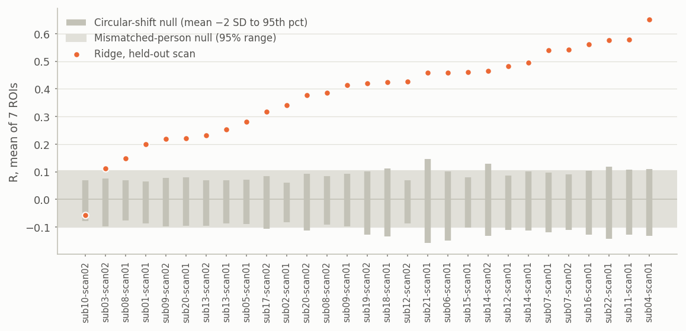
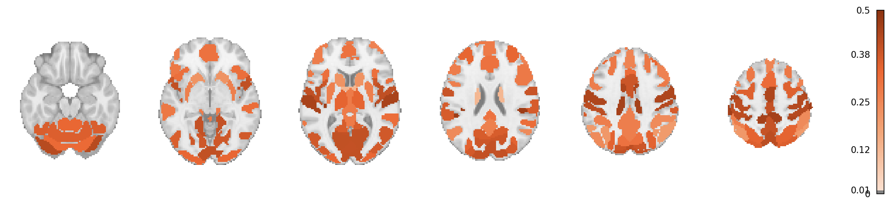
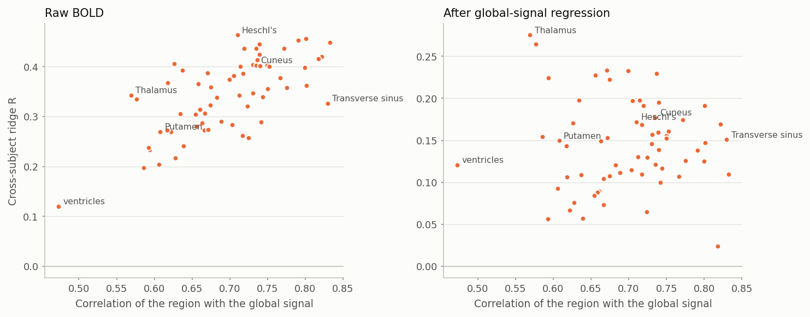
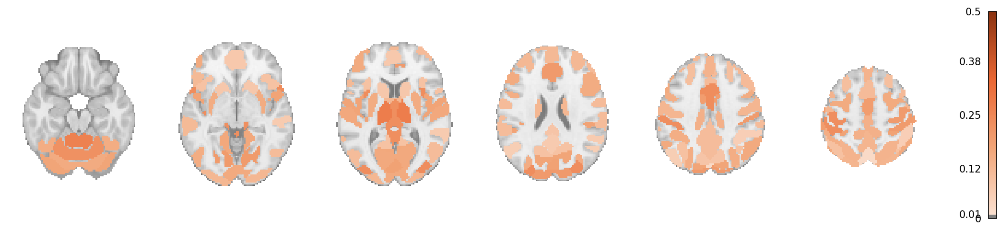
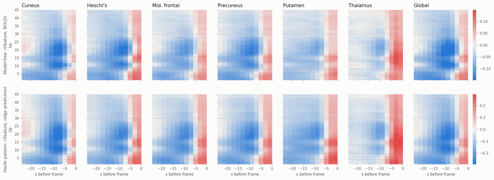
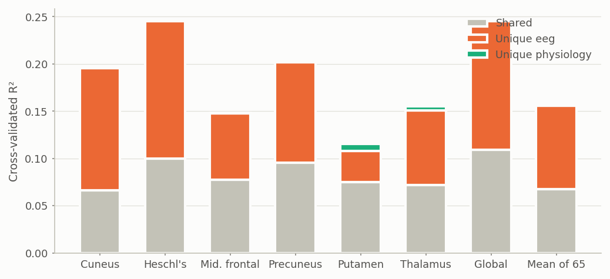
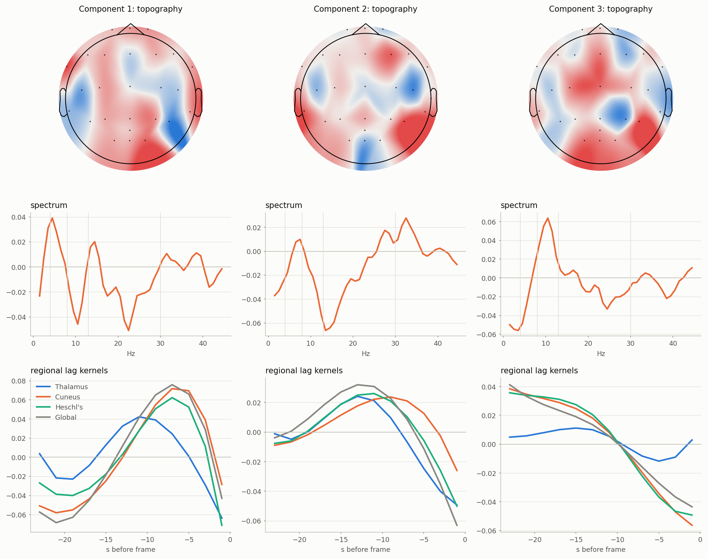

# What EEG-to-BOLD models learn

Seamus Taylor · 18 October 2026 · VU resting-state EEG-fMRI (22 people, 29 scans) · analyses run on Monash M3

The hypothesis tests showed that ridge regression on lagged EEG power predicts a new person's BOLD better than NeuroBOLT (mean R 0.381 against 0.336 across all 22 people), that NeuroBOLT's pretrained transformer branch adds nothing, and that a single vigilance index carries much of the signal. This round asks why, so the results can be explained and built on. Each of eight questions below has its own analysis; every number is cross-validated so that no model is scored on a person it saw.

## Bottom line

- **The prediction is real.** 28 of 29 held-out scans beat their own circular-shift null, and scoring one person's prediction against another person's BOLD gives R = 0.00, so no drift shared across scans inflates the result.
- **It is mostly the brain-wide signal.** A region's predictability tracks how closely it follows the global signal (ρ = +0.65 over 64 regions). Removing the global signal cuts mean R from 0.34 to 0.14; what survives is concentrated in the thalamus (0.28), cerebellum and mid-cingulate, regions whose arousal response runs against cortex.
- **The models read whole-head band power through a haemodynamic delay.** Sixty channel-averaged band powers keep 93% of the skill and scalp topography adds nothing. Free lag weights matter: forcing the canonical HRF shape loses 0.16 R. Cortex couples negatively with alpha and beta power 8–12 s earlier; the thalamus couples positively and about 6 s sooner; and broadband power in the last 4 s couples positively everywhere, most likely shared arousal transients.
- **NeuroBOLT is in effect a linear band-power model.** A ridge model fitted to imitate NeuroBOLT's outputs reproduces them at R = 0.91 on held-out scans and predicts BOLD better than NeuroBOLT does (0.491 against 0.465). Perturbing the EEG the same way moves both models' predictions alike, with the last 4 s mattering most; NeuroBOLT leans more on delta power.
- **The body carries much of the same information.** Heart rate alone predicts BOLD at R = 0.22, and heart rate with slow eye movements and muscle activity at 0.26, with no EEG at all. Head-motion loops add nothing beyond EEG. Everything the body signals predict, EEG already predicts: they share about 44% of EEG's explained variance, and physiology adds almost nothing unique (R² +0.001).
- **Nonlinearity does not help at this data size.** MLPs, additive splines, interactions, vigilance-gated coupling, learned frequency bands and a spline Hammerstein model all tie or trail ridge. The MEL preprint's large MLP gain on these data does not replicate (+0.01 under the same leave-one-person-out protocol).
- **An interpretable model keeps 96% of the skill with 0.2% of the parameters.** Five shared scalp-spectral components with smooth regional lag kernels (2,040 parameters) reach 0.329 against 0.344 for full ridge (892,000 weights) over 65 targets.
- **Personal calibration barely helps.** Using half of a person's own scan to adjust the delay or add their own band powers changes R by under 0.01. Predictable people are those whose arousal markers fluctuate: EEG theta (ρ = +0.66), slow eye movements (+0.53) and heart rate (+0.40).

Taken together, resting-state EEG tells us where a person sits on the arousal axis, seen through the haemodynamic delay, and linear models already read all of it. The ceiling is the arousal variance in each scan, not model capacity. The open question worth publishing is the region-specific remainder.

## How to read the numbers

- **R** is the correlation between predicted and measured BOLD over one held-out scan (about 560 frames, 20 minutes).
- **5-fold subject-grouped CV** splits the 22 people into five groups (fold 1 is the authors' split); each person is held out once, and penalties and stopping are chosen on separate validation people. Results are averaged within person, then over people; 95% intervals and paired differences are over people.
- **Targets** are the 64 DiFuMo regions plus the global signal; the paper's seven ROIs are a subset.
- **GSR** (global-signal regression) removes, per scan, the part of each region's time series that follows the global signal.
- **Ridge** throughout means the best earlier model: log power of 26 channels in 44 one-Hz bins over 12 two-second lags (24 s of EEG history), 13,728 features.

## 1. Is the prediction real?

| Null model | Controls for | Result |
| --- | --- | --- |
| Circular shift: prediction vs the scan's own BOLD shifted by at least 63 s | Autocorrelated slow signals | Null SD 0.054 per scan, 95th percentile 0.090; 28 of 29 scans significant |
| Mismatched people: one person's prediction vs another person's BOLD (798 pairs) | Anything time-locked to the scan, such as drowsiness that builds the same way in everyone | Mean R −0.003 (95% of pairs within ±0.10), against 0.379 matched |
| Time in scan only (smooth functions of frame index) | Slow drift | R = −0.010 |

- Slow, autocorrelated time series correlate by chance at 0.1–0.2 over a scan, so each scan needs its own null.
- The mismatched-person null is the decisive one. If people drifted towards sleep in the same way, one person's prediction would match another's BOLD; it does not.
- The one scan under its null (sub10-scan02) is in the fold with the least predictable people.

## 2. Where in the brain?

| Network | Regions | R (raw BOLD) | R after GSR |
| --- | --- | --- | --- |
| Somatomotor (incl. auditory) | 10 | 0.432 | 0.162 |
| Visual | 13 | 0.385 | 0.170 |
| Salience | 7 | 0.370 | 0.137 |
| Dorsal attention | 8 | 0.366 | 0.128 |
| Cerebellum | 2 | 0.284 | 0.244 |
| Default | 12 | 0.283 | 0.105 |
| Subcortical (thalamus, putamen, caudate) | 3 | 0.276 | 0.167 |
| Control | 6 | 0.261 | 0.107 |
| Ventricles, venous sinus, fornix | 3 | 0.243 | 0.166 |
| Global signal | 1 | 0.453 | – |

- Sensory and motor cortex are predicted best, control and default-mode regions worst. This is the spatial pattern of the arousal-related global signal, which is largest in sensory cortex (Chang et al. 2016, PNAS; Bolt et al. 2025, Nature Neuroscience).
- Predictability follows each region's correlation with the global signal (ρ = +0.65, p < 10⁻⁸). After GSR the relation is gone (ρ = +0.06).
- GSR cuts mean R from 0.34 to 0.14 over 64 regions. The remainder is far above chance: the null SD of a 29-scan mean is about 0.01.

- After GSR the best regions are the thalamus (0.28), cerebellum I–V (0.26) and mid-anterior cingulate (0.23). In eyes-closed rest, thalamic BOLD rises with alpha while cortical BOLD falls (Goldman 2002; Moosmann 2003; Liu 2012), and thalamus and cingulo-opercular regions move against sensory cortex in arousal templates. The region-specific EEG information sits where the literature says it should.
- The literature review found no published EEG-to-BOLD prediction study that reports accuracy after GSR. This is the natural benchmark for any model that claims to learn more than brain state.

## 3. Which EEG features carry the signal?

| Ridge features (5-fold CV) | Per frame | R, 7 ROIs (95% CI) | Δ vs full | R, 65 targets |
| --- | --- | --- | --- | --- |
| 26 channels × 44 one-Hz bins × 12 lags | 13,728 | 0.381 (0.306 to 0.456) | – | 0.344 |
| 5 bands × 5 scalp regions × 12 lags | 300 | 0.355 (0.280 to 0.430) | −0.026 | 0.325 |
| 5 bands, channel-averaged × 12 lags | 60 | 0.355 (0.283 to 0.427) | −0.026 | 0.321 |
| Vigilance index (alpha ÷ delta+theta) × 12 lags | 12 | 0.211 (0.154 to 0.268) | −0.170 | 0.229 |
| Time in scan only | 8 | −0.010 | −0.392 | −0.007 |

- Five scalp regions do no better than the channel average: the signal is a whole-head spectral one. Fine frequency resolution adds 0.026.
- In explained variance (R²), the 60 band powers keep about 87% of the full model and the vigilance index about 31%.

## 4. What is the time course?

| Lag structure (ridge on channels × 1 Hz bins) | R, 7 ROIs | Δ vs free lags |
| --- | --- | --- |
| Free weights on 12 two-second lags | 0.381 | – |
| Canonical HRF plus temporal and dispersion derivatives | 0.325 | −0.056 |
| Canonical HRF only (SPM double gamma) | 0.217 | −0.164 |

- Forcing EEG power through the textbook HRF loses 40% of the skill; its two derivatives recover two-thirds of the loss. The data want a different, region-dependent response.

- **Top row, model-free:** the within-scan correlation of each 1 Hz power bin at each lag with BOLD, averaged over the 29 scans. **Bottom row, model:** the same for the ridge prediction (Haufe patterns, which unlike raw weights are safe to read with correlated features). The two rows agree, so ridge reads what is in the data.
- **Cortex and the global signal:** power 8–12 s before a frame, strongest at 8–25 Hz (alpha and beta), predicts lower BOLD (alpha r = −0.25 in cuneus and the global signal, t ≈ −12 over scans). This is the inverse alpha–BOLD coupling of the EEG-fMRI literature, delayed by the haemodynamic response.
- **Thalamus:** the sign flips. Alpha and beta power predict higher thalamic BOLD (beta r = +0.24, alpha +0.20), and the lag is about 3 s rather than 9 s. A rank-1 (channel × spectrum × lag) model per region puts the thalamic lag peak at 3 s against 7–11 s for cortex. Positive thalamic alpha coupling and an earlier thalamic response were both reported in within-subject studies (Goldman 2002; de Munck 2007); here they hold across people.
- **The last 4 s:** broadband power (all frequencies) just before a frame predicts higher BOLD in every region, most strongly in the thalamus. It survives in the Haufe patterns, so it is not a suppressor artefact of the weights. A broadband, near-zero-lag co-fluctuation of EEG power and BOLD is what shared arousal transients produce (Bolt et al. 2025 report EEG power and the global signal moving together with the body's arousal signals).
- Alpha power couples negatively with all 65 targets at some lag; 36 also show a positive lobe, mostly at short lag.

## 5. What does NeuroBOLT learn?

| Held-out scans of the authors' split | R |
| --- | --- |
| Linear surrogate (ridge on band power fitted to NeuroBOLT's output) vs NeuroBOLT's output | **0.912** |
| Ridge trained on BOLD vs NeuroBOLT's output | 0.852 |
| NeuroBOLT vs BOLD | 0.465 |
| Linear surrogate vs BOLD | 0.491 |
| Ridge vs BOLD | 0.504 |

- A linear map from band power reproduces 83% of the variance of NeuroBOLT's predictions; the authors' published checkpoints give the same picture (0.851).
- The surrogate predicts BOLD better than NeuroBOLT itself: the part of NeuroBOLT's output that is not linear in band power is mostly noise.

**Matched permutation importance.** On the six held-out scans, one part of each EEG window was swapped with the same part of a window at least 60 s away, so its statistics stay realistic but its timing relative to BOLD is broken. Every model saw the same perturbed EEG.

| Part swapped | Drop in R: ridge | NeuroBOLT (ours) | NeuroBOLT (published) |
| --- | --- | --- | --- |
| Delta band (0.5–4 Hz) | 0.034 | 0.108 | 0.122 |
| Theta band (4–8 Hz) | 0.017 | 0.020 | 0.023 |
| Alpha band (8–13 Hz) | 0.015 | 0.025 | 0.030 |
| Beta band (13–30 Hz) | 0.271 | 0.138 | 0.148 |
| Gamma band (30–45 Hz) | 0.014 | 0.002 | 0.002 |
| Frontal channels | 0.086 | 0.035 | 0.028 |
| Occipital channels | 0.018 | 0.025 | 0.050 |
| Last 4 s of the window | 0.187 | 0.196 | 0.187 |
| 4–8 s before | 0.093 | 0.056 | 0.071 |
| 8–12 s before | 0.121 | 0.122 | 0.096 |
| 12–16 s before | 0.079 | 0.082 | 0.082 |

- Both models depend on time in the same way: the last 4 s matter most, then 8–12 s, which are the two coupling lobes in the maps above.
- The band column is about unique reliance, not total importance. Alpha and beta power rise and fall together, so swapping alpha alone leaves beta carrying the same information; a model that leans on beta then shows a small alpha drop. The broad beta band also covers 17 of the 44 one-Hz bins.
- NeuroBOLT leans more on delta power than ridge does (0.11 against 0.03). Delta in frontal channels is where slow eye movements, a drowsiness marker, appear in eyes-closed EEG.

## 6. Brain or body?

The recordings include eye (EOG), muscle (EMG) and heart (ECG) channels and, in 19 scans, carbon-wire loops that measure head motion. Arousal changes all of these as well as EEG, so they are both possible confounds and alternative read-outs of the same state.

- **Caution:** the EOG, EMG and ECG leads share the EEG reference, so their power in EEG bands is partly EEG itself (raw EOG alone reaches 0.313). Claims about the body use only measures EEG amplitude cannot explain: heart rate, EOG below 4 Hz (slow eye movements, blinks) and EMG above 30 Hz (muscle).

| Ridge features (5-fold CV) | R, 7 ROIs | R, 65 targets |
| --- | --- | --- |
| EEG | 0.381 | 0.344 |
| Heart rate only | 0.218 | 0.195 |
| Slow EOG only | 0.194 | 0.168 |
| High-frequency EMG only | 0.195 | 0.164 |
| Heart rate + slow EOG + high EMG | 0.257 | 0.218 |
| Motion loops only (19 scans) | 0.232 | 0.200 |
| EEG, same 19 scans | 0.391 | 0.354 |
| EEG + motion loops (19 scans) | 0.391 (Δ +0.001) | 0.353 |

**Variance partition.** Ridge was fitted on EEG alone, physiology alone, and both together (with separate penalties), and cross-validated R² was split into the part only EEG explains, the part only physiology explains, and the shared part.

| Target | R² EEG | R² physiology (EEG-free) | Unique to EEG | Unique to physiology | Shared |
| --- | --- | --- | --- | --- | --- |
| Cuneus | 0.196 | 0.066 | 0.130 | 0.000 | 0.066 |
| Heschl's gyrus | 0.245 | 0.100 | 0.145 | 0.000 | 0.100 |
| Thalamus | 0.151 | 0.077 | 0.078 | 0.005 | 0.072 |
| Global signal | 0.246 | 0.110 | 0.136 | 0.001 | 0.109 |
| Mean of 65 targets | 0.156 | 0.069 | 0.088 | 0.001 | 0.068 |

- Physiology adds almost nothing unique (R² +0.001 on average). Adding heart rate to EEG raises R by 0.005, which is reliable but tiny.
- EEG and the body signals share about 44% of what EEG explains; the rest is unique to EEG. With all non-EEG channels, including their EEG-contaminated bands, the shared part rises to 70%.
- Reading: heart rate, eye movements and muscle tone are co-markers of the same arousal state that EEG reads, not separate routes to BOLD that EEG misses. Respiration and CO₂, the main missing physiological measures, are not recorded in this dataset.

## 7. Does nonlinearity help?

| Readout of identical features | Protocol | R, 7 ROIs | Δ vs ridge (95% CI) | People better |
| --- | --- | --- | --- | --- |
| MLP, 60 band powers (5-seed ensemble) | 5-fold | 0.361 | +0.006 (−0.012 to +0.024) | 14 of 22 |
| MLP, 60 band powers | Leave one person out | 0.375 | +0.010 (−0.007 to +0.026) | 15 of 22 |
| MLP, 26 channels × 5 bands × 12 lags | Leave one person out | 0.378 | +0.005 (−0.014 to +0.024) | 13 of 22 |
| Additive splines, 60 band powers | 5-fold | 0.347 | −0.008 (−0.017 to +0.001) | 6 of 22 |
| Vigilance × band interactions | 5-fold | 0.347 | −0.008 (−0.022 to +0.006) | 8 of 22 |
| All pairwise interactions | 5-fold | 0.287 | −0.068 (−0.107 to −0.030) | 4 of 22 |
| Learned frequency bands, end to end from raw EEG | 5-fold | 0.355 | −0.026 vs 1 Hz ridge (−0.040 to −0.011) | – |

- The MLP chose its most heavily regularised settings almost every time, as expected when the best function is close to linear.
- The MEL preprint (arXiv 2608.29304, same VU data) reports an MLP ensemble at 0.499 against ridge at 0.439 under leave-one-subject-out. Under the same protocol on our features the gain is +0.01 and not significant: the claim does not replicate.
- The learned-band model (a SincNet-style filterbank applied in the frequency domain, trained end to end) keeps its filters close to their log-spaced start and trails fixed 1 Hz bins.

## 8. An interpretable time-series model

The literature review proposed a shared-factor Hammerstein distributed-lag model: K components shared by all 65 targets, each a scalp topography times a 1 Hz spectral profile; an optional static nonlinearity per component; and a smooth lag kernel per region and component (five B-splines over 0–24 s), which acts as an empirical, region-specific HRF.

| Model (5-fold CV) | Parameters | R, 65 targets | Δ vs full ridge (95% CI) | R, 7 ROIs |
| --- | --- | --- | --- | --- |
| Full ridge | 892,320 | 0.344 | – | 0.381 |
| 1 component | 460 | 0.303 | −0.042 (−0.061 to −0.022) | 0.336 |
| 3 components | 1,250 | 0.324 | −0.020 (−0.036 to −0.003) | 0.359 |
| 5 components | 2,040 | 0.329 | −0.015 (−0.032 to +0.001) | 0.362 |
| 8 components | 3,225 | 0.327 | −0.017 (−0.032 to −0.003) | 0.358 |
| 5 components + spline nonlinearity | 2,060 | 0.329 | −0.015 (−0.032 to +0.002) | 0.362 |

- One shared component already reaches 88% of ridge; five reach 96% with 0.2% of the parameters. Beyond five, nothing is gained.
- The spline nonlinearity adds exactly nothing, which rules out the vigilance-gated (state-dependent) coupling that the literature suggested as the one place nonlinearity might pay.
- The predicted 0.01 loss threshold was missed narrowly (−0.015) and the 0.02 falsifier was not reached: the model is a usable compact description, not a replacement.

- The figure shows fold 1's three-component model, refitted with a smoothness penalty on the spectra (same accuracy: 0.330 for five components).
- **Component 1** weighs alpha (~10 Hz) and beta (~22 Hz) power negatively and theta positively. Its cortical and global kernels peak about 7 s before the frame, the classic inverse alpha–BOLD coupling through the HRF. The thalamic kernel peaks about 4 s further back.
- **Component 3** is the vigilance index in spectral form (alpha up, delta down). Its cortical kernels are derivative-shaped, so a recent rise in vigilance lowers BOLD and an older one raises it; the thalamus barely responds.
- Every component's kernel turns sharply negative in the last 2 s before the frame. That is the short-lag, opposite-sign term seen in the ridge weights; it appears in all regions and in the global signal alike.
- The topographies are noisy, consistent with scalp detail adding nothing.

## 9. Does personal calibration help?

The first half of each held-out scan was used for calibration and the second half for scoring, with a 25 s gap so no EEG window spans both.

| Second half of each held-out scan (7 ROIs) | R | Δ vs population model (95% CI) | People better |
| --- | --- | --- | --- |
| Population model (other people only) | 0.401 | – | – |
| Population model with a person-specific delay (±6 s) | 0.406 | +0.006 (−0.019 to +0.031) | 10 of 22 |
| The person's own 60 band powers only | 0.394 | −0.006 (−0.049 to +0.037) | 10 of 22 |
| Population model + own band powers | 0.409 | +0.008 (−0.030 to +0.047) | 10 of 22 |

- The chosen delay shifts were mostly zero or one frame: person-specific HRF timing is not what limits cross-subject prediction here.
- Who is predictable depends on how much their arousal moves: Spearman ρ between a scan's R and its fluctuation in slow eye movements is +0.53 (p = 0.003), in heart rate +0.40 (p = 0.035), and earlier, in EEG theta power +0.66.

## 10. Predictions from the literature review, scored

The literature review set numeric predictions and falsifiers for each analysis, written without access to these results.

| Prediction | Result | Verdict |
| --- | --- | --- |
| Mismatched-person and drift-only R ≤ 0.05; matched-minus-mismatched gap ≥ 0.30 | −0.003 and −0.010; gap 0.38 | Confirmed |
| Motion-loop or muscle-only R ≤ 0.10 | Motion loops 0.23, high-frequency EMG 0.20 | Falsified: body signals carry arousal |
| Motion loops or EMG alone match EEG in Heschl's gyrus or precuneus (falsifier of EEG coupling) | Heschl's 0.29 and 0.22 vs EEG 0.47; precuneus 0.22 and 0.19 vs 0.40 | Not triggered |
| GSR residual mean R 0.05–0.15, concentrated in thalamus, cingulo-opercular and visual cortex | 0.144; thalamus 0.28, mid-cingulate 0.23, visual 0.17 | Confirmed |
| GSR residual above null only in a minority of regions | 63 of 64 regions above 0.05, 52 above 0.10 | Falsified: region-specific signal is widespread |
| Vigilance share far below its raw-target share after GSR | 45% of full-model R after GSR vs 66% before | Confirmed |
| Canonical-HRF collapse loses ≥ 0.04 R; derivatives recover ≥ half | Loses 0.164; derivatives recover 66% | Confirmed |
| Linear surrogate reproduces NeuroBOLT at R ≥ 0.9 | 0.912 (our checkpoints), 0.851 (published) | Confirmed for ours, near for published |
| MLP beats ridge on the same cube by ≥ 0.02 with ≥ 15 of 22 people | +0.005 (leave one out), 13 of 22 | Falsified |
| Hammerstein with K ≤ 5 within 0.01 of ridge (falsifier: loss > 0.02) | −0.015 | Between the two thresholds |
| Hammerstein splines add ≥ 0.015 over linear | +0.000 | Falsified |
| Calibrated HRF latency raises R by ≥ 0.02 | +0.006 | Falsified: timing is not the bottleneck |
| Thalamic lag profile peaks at least 1 s earlier than cortex | 3 s against 7–11 s before the frame | Confirmed |
| Short-lag lobe at least 50% smaller in Haufe patterns than in raw weights | Persists in patterns as a broadband component in every region | Falsified: favours a shared arousal transient |
| EEG adds at least 0.10 R over all EEG-free nuisance blocks | 0.381 against 0.257 (+0.124) | Confirmed |

## 11. Future research directions

Ordered by priority. Each has a test whose outcome would change the plan.

| Direction | Test | Changes the plan if |
| --- | --- | --- |
| 1. Make the region-specific remainder the benchmark | Score every model on GSR residuals (thalamus, cingulate, cerebellum, visual cortex) against the mismatched-person null, alongside raw targets | A model beats ridge on residuals: the first evidence of learning beyond brain state |
| 2. Validate on locked external data | Frozen VU ridge and Hammerstein models on ds005795 (eyes closed, motion loops, respiration) and ds003768 (same TR and amplifier); then train on about 150 pooled people | Frozen R below 0.15 (the VU result is site-specific), or pooling lifts ridge by 0.05 or more (the plateau was a VU property) |
| 3. Widen the arousal range | Sleep and long recordings (ds003768 sleep runs, ds003574, ds005127): hours per person and the full wake–sleep axis | Nonlinear models finally beat ridge: the regime where capacity pays |
| 4. Report with the interpretable model | The shared-factor Hammerstein model as the reporting model: regional HRF kernels with intervals, component shares per region | It loses more than 0.02 R on external data |
| 5. Model brain and body together | EEG, heart rate, eye movements and respiration as joint arousal read-outs on ds005795; EEG's unique share per region | EEG adds nothing beyond physiology in region-specific targets |

- **Do now on the existing data:** score NeuroBOLT and the MLP on the GSR targets; add the mismatched-person null to every future table; test TabPFN-2.5 as a cheap nonlinear baseline on the 60 band powers.
- **Start now, in parallel:** download and preprocess ds005795 and ds003768 into DiFuMo-64 time series with one shared pipeline. It is the long pole.
- **Deprioritise:** larger encoders, EEG foundation-model adapters, state-space models and time-series foundation models. Each addresses capacity or context length, and neither limits these data. TimesFM and Chronos-2 also handle lagged covariates poorly (Won 2026, preprint).
- **Standard for any new model:** a paired per-person test against a tuned lagged ridge on the same folds, plus the mismatched-person null.

## Methods and code

- **Data.** VU eyes-closed rest: 22 people, 29 scans, 26 EEG channels at 200 Hz after resampling, TR 2.1 s; DiFuMo-64 regions plus the cleaned global signal, low-passed at 0.15 Hz; EOG, EMG, ECG and, in 19 scans, four carbon-wire loops.
- **Features.** Log power per channel in 1 Hz bins (1–45 Hz) and 12 two-second lags before each frame. Non-EEG channels: log power in seven bands × 12 lags; heart rate from ECG R peaks (no usable peaks in sub17-scan02).
- **Models.** Ridge with the penalty chosen per target on validation people; combined feature blocks get separate penalty scales. NeuroBOLT analyses use the seven per-region checkpoints of the inter-subject reproduction and the authors' published checkpoints.
- **Code.** `scripts/interp_build_cache.py`, `interp_cv.py`, `interp_maps.py`, `interp_attribution.py`, `interp_nonlinear.py`, `interp_tsmodel.py`, `interp_hammerstein.py` and `interp_personal.py` run on M3 through `scripts/interp_m3.sbatch`; `bash scripts/refresh_interp_report.sh` rebuilds `reports/interpretability/tables.md` and the figures.
- **Literature.** The full review, with 117 citations and preprints labelled, is `reports/EEG BOLD interpretability and directions.md`.
