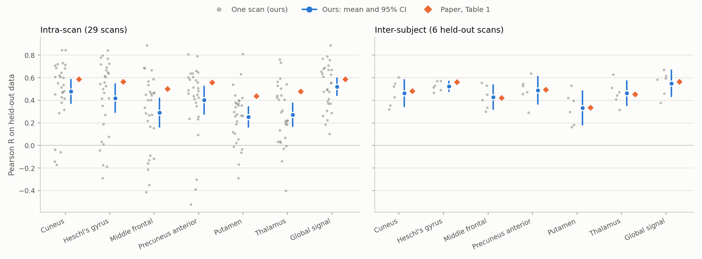
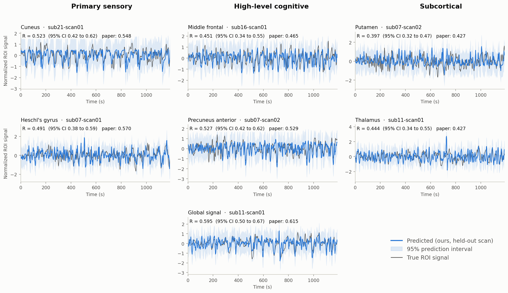

# NeuroBOLT reproduction: Table 1 and Figure 5

NeuroBOLT rows only, retrained from the public release on MASSIVE M3. Every score is the Pearson R between predicted and true BOLD on held-out data.

## Summary

- **Inter-subject prediction reproduces.** Averaged over the seven regions, our retrained models score R = 0.465 on the six held-out scans, against 0.473 in the paper. The paper's value lies inside our 95% CI for every region.
- **The authors' published checkpoints reproduce the paper's inter-subject row exactly**, including every ± value, when re-scored scan by scan. This confirms that the ± is the SD across the six held-out scans, and that those numbers come from validation-selected epochs.
- **Intra-scan prediction does not reproduce.** With each run's epoch chosen on validation data, as the paper describes, we get R = 0.377 against the paper's 0.531. The paper's mean lies outside our 95% CI for six of the seven regions. If instead each run's epoch is chosen by its *test* score, which is not a valid estimate, we get 0.543, within 0.015 of the paper in six regions.
- **Figure 5 is recreated on the same held-out scans the paper shows**, with a 95% prediction interval around each prediction. The bands are wide, about ±1.2 on a signal whose 95th-percentile amplitude is 1, and they cover 97–98% of the true values on the held-out scans. At R ≈ 0.45 the model follows the shape of the BOLD signal, but any single time point is uncertain.

## 1. What was run

| | Paper | This reproduction |
|---|---|---|
| Data | 29 resting scans, 22 subjects, DiFuMo-64 ROIs, TR = 2.1 s | Same public release ([NeurdyLab/NeuroBOLT](https://huggingface.co/datasets/NeurdyLab/NeuroBOLT)), 567 EEG windows per scan |
| Intra-scan split | First 80% train, 10% validation, last 10% test, 20 s gaps | Same code path: 453 / 46 / 48 windows per scan with 10-TR (21 s) gaps. All 29 scans × 7 ROIs |
| Inter-subject split | 18 / 5 / 6 scans, subjects kept together | The authors' `scan_split_example.xlsx` (fold1): 10,206 / 2,835 / 3,402 windows |
| Training | 30 epochs (5 warm-up), peak lr 3e-4, AdamW β = (0.9, 0.99), batch 16 / 64, LaBraM-base init | Same, except AdamW β = (0.9, 0.999). That is the code default, and the authors' published checkpoints record it too |
| EEG filtering | None in the main setting | None for intra-scan. A 0.5 Hz high-pass for inter-subject, which `prepare_full_dataloader` hardcodes |
| Epoch choice | "selected based on the validation set" | Minimum validation MSE, the rule `main.py` itself uses |
| Seeds | One fixed seed | One (12345) |

The code was upstream NeuroBOLT `b51b966`, unmodified. Training ran as array job 60714934 (210 runs, 4–5 October 2026). Per-scan evaluation ran as job 60931610 (12 October 2026) on an A40.

## 2. Table 1, NeuroBOLT rows

Mean ± SD of per-scan Pearson R. Intra-scan uses 29 scans; inter-subject uses the 6 held-out scans.

| Setting | Source | Cuneus | Heschl's gyrus | Middle frontal | Precuneus ant. | Putamen | Thalamus | Global signal | Avg. R |
|---|---|---|---|---|---|---|---|---|---|
| Intra-scan | Paper | 0.588 ± 0.166 | 0.566 ± 0.183 | 0.502 ± 0.168 | 0.559 ± 0.141 | 0.437 ± 0.184 | 0.480 ± 0.213 | 0.587 ± 0.162 | 0.531 |
| Intra-scan | **Ours** | 0.480 ± 0.276 | 0.420 ± 0.331 | 0.290 ± 0.334 | 0.401 ± 0.323 | 0.253 ± 0.237 | 0.273 ± 0.268 | 0.521 ± 0.201 | **0.377** |
| Inter-subject | Paper | 0.482 ± 0.100 | 0.561 ± 0.046 | 0.423 ± 0.115 | 0.496 ± 0.136 | 0.335 ± 0.144 | 0.453 ± 0.106 | 0.564 ± 0.115 | 0.473 |
| Inter-subject | **Ours** | 0.464 ± 0.113 | 0.524 ± 0.042 | 0.429 ± 0.103 | 0.489 ± 0.116 | 0.332 ± 0.144 | 0.464 ± 0.104 | 0.550 ± 0.110 | **0.465** |
| Inter-subject | Authors' checkpoints, re-scored | 0.481 ± 0.100 | 0.561 ± 0.046 | 0.423 ± 0.115 | 0.496 ± 0.136 | 0.335 ± 0.144 | 0.453 ± 0.106 | 0.564 ± 0.115 | 0.473 |

95% confidence intervals for our means (t-interval across scans). ✱ marks a region where the paper's mean falls outside our interval.

| Setting | Cuneus | Heschl's gyrus | Middle frontal | Precuneus ant. | Putamen | Thalamus | Global signal |
|---|---|---|---|---|---|---|---|
| Intra-scan | 0.375 to 0.585 ✱ | 0.294 to 0.546 ✱ | 0.163 to 0.417 ✱ | 0.278 to 0.524 ✱ | 0.162 to 0.343 ✱ | 0.171 to 0.375 ✱ | 0.445 to 0.598 |
| Inter-subject | 0.345 to 0.583 | 0.480 to 0.568 | 0.321 to 0.537 | 0.367 to 0.611 | 0.181 to 0.484 | 0.354 to 0.573 | 0.435 to 0.666 |



*Each grey dot is one scan. Blue shows our mean and its 95% CI. Orange shows the paper's Table 1 value.*

## 3. Findings

### 3.1 Inter-subject prediction reproduces

Our per-region means are within 0.04 of the paper's. The largest gap is Heschl's gyrus, 0.524 against 0.561. All seven paper values sit inside our CIs, and the average gap is 0.008. The CIs are wide (about ±0.1) because there are only six held-out scans, from five people (sub07 contributes two). So this comparison would catch a large discrepancy, not a subtle one.

The per-scan evaluation reproduces `main.py`'s logged scores to nine decimal places. Every scan yields 567 windows, so the six test batches `main.py` forms line up exactly with the six scans. Its logged inter-subject R is therefore already the mean of the per-scan Rs. What it does not record is the spread across scans.

### 3.2 The authors' checkpoints pin down how the paper's inter-subject row was produced

Each published checkpoint ([ssssssup/NeuroBOLT](https://huggingface.co/ssssssup/NeuroBOLT)) stores its training arguments and the epoch at which it was saved, with that epoch's validation and test scores. `main.py` writes a checkpoint only when validation MSE improves. Three things follow.

- **The paper's inter-subject numbers are validation-selected.** The stored test R reproduces Table 1 to three decimals for six regions. Cuneus is stored as 0.481 against 0.482 in the paper. The selected epochs are 3–13 of 30.
- **The ± is the SD across the six held-out scans.** We re-scored the checkpoints scan by scan with our evaluator, and every mean and SD in the row matches the paper.
- **The authors trained without the EEG high-pass, and with AdamW β₂ = 0.999.** Their scores match only when the 0.5 Hz high-pass is left off. With it on, the same checkpoints average 0.437, and Heschl's gyrus falls from 0.561 to 0.442. The released `prepare_full_dataloader` applies that high-pass, so our models were trained on slightly different input from the authors'. The checkpoints also record `opt_betas=None`, which means PyTorch's default β = (0.9, 0.999), not the (0.9, 0.99) listed in the paper's Table 5.

### 3.3 Intra-scan prediction does not reproduce under validation-based selection

The paper's intra-scan row is matched closely only when each run's epoch is chosen by its test score.

| Epoch chosen by | Cuneus | Heschl's | Mid. frontal | Precuneus | Putamen | Thalamus | Global | Avg. R | RMS gap to paper |
|---|---|---|---|---|---|---|---|---|---|
| Paper | 0.588 ± 0.166 | 0.566 ± 0.183 | 0.502 ± 0.168 | 0.559 ± 0.141 | 0.437 ± 0.184 | 0.480 ± 0.213 | 0.587 ± 0.162 | 0.531 | |
| Min validation MSE (`main.py`) | 0.480 ± 0.276 | 0.420 ± 0.331 | 0.290 ± 0.334 | 0.401 ± 0.323 | 0.253 ± 0.237 | 0.273 ± 0.268 | 0.521 ± 0.201 | 0.377 | 0.162 |
| Max validation R | 0.414 ± 0.254 | 0.457 ± 0.301 | 0.337 ± 0.315 | 0.319 ± 0.377 | 0.235 ± 0.278 | 0.294 ± 0.238 | 0.504 ± 0.259 | 0.366 | 0.173 |
| Last epoch | 0.476 ± 0.303 | 0.477 ± 0.297 | 0.358 ± 0.268 | 0.405 ± 0.313 | 0.330 ± 0.217 | 0.324 ± 0.237 | 0.560 ± 0.185 | 0.419 | 0.120 |
| Max test R (oracle, not valid) | 0.603 ± 0.186 | 0.581 ± 0.193 | 0.512 ± 0.184 | 0.549 ± 0.168 | 0.445 ± 0.167 | 0.483 ± 0.177 | 0.630 ± 0.124 | 0.543 | 0.019 |
| Min validation MSE, the 6 inter-subject test scans only | 0.631 ± 0.128 | 0.652 ± 0.143 | 0.455 ± 0.426 | 0.627 ± 0.159 | 0.298 ± 0.356 | 0.467 ± 0.310 | 0.594 ± 0.278 | 0.532 | 0.071 |

The three validation-based rules give an average of 0.366–0.419. Choosing each run's epoch by its test R gives per-region means within 0.015 of the paper's in six regions; the global signal is the exception, at 0.630 against 0.587. Its SDs (0.12–0.19) also resemble the paper's (0.14–0.21) much more than the validation-selected SDs do (0.20–0.33). Restricting to the six inter-subject test scans gives a similar average (0.532), but it fits the regional pattern far worse (RMS gap 0.071 against 0.019).

This pattern is consistent with the paper's intra-scan row reflecting test-based epoch choice, but it does not establish that. We trained one seed on different GPUs, and the paper states neither how many scans the intra-scan row covers nor which validation criterion it used. Two code details matter here. `main.py` scores the test set every epoch and logs it to TensorBoard beside the validation scores, which makes a test-based choice easy to make without meaning to. And the inter-subject setting is unaffected, since §3.2 shows those numbers were validation-selected. **The authors should be asked how the intra-scan epochs were chosen** before the intra-scan row is cited or compared against.

### 3.4 Intra-scan scores are dominated by short evaluation windows

Each intra-scan run is validated on 46 windows (97 s) and tested on 48 (101 s), and the target is low-pass filtered at 0.15 Hz. Per-scan R ranges from −0.52 to 0.89. 13% of runs score below zero, rising to 24% for the middle frontal gyrus; no global-signal run does. The validation-MSE minimum lands anywhere from epoch 0 to 29 (median 9–14 by region). Simply taking the last epoch beats it on average (0.419 against 0.377), so the validation segment is too short to choose epochs reliably. Averaged over all 203 runs, test R rises until about epoch 16 and then levels off at 0.42.

### 3.5 Inter-subject models stop improving after a few epochs

Validation MSE bottoms out at epoch 3–8 in our runs and 3–13 in the authors'. Beyond that point, training R keeps rising, reaching 0.50–0.66 by epoch 29, while validation and test scores fall. For Cuneus, validation MSE rises from 0.246 to 0.294 and test R falls from 0.464 to 0.406 by the last epoch. Most of the 30-epoch schedule is therefore spent overfitting the 13 training subjects.

### 3.6 Uncertainty: wide prediction intervals, and dropout does not provide one

The Figure 5 bands are split-conformal 95% prediction intervals. We take the 95th-percentile absolute error on the five validation scans and add it around each held-out prediction. On the six held-out scans these bands cover 97–98% of true values. That is slightly conservative, because the validation scans are harder (validation R ≈ 0.3) than the test scans. Their half-width is ±1.10 to ±1.26 on the plotted, normalized scale, or ±0.91 to ±0.97 when predictions are left at the model's own output scale (coverage 95–97%). By contrast, a band built from Monte Carlo dropout (20 stochastic passes) has an SD of only 0.004–0.011. It covers 1–3% of true values, so dropout-based uncertainty is not a usable confidence interval for this model.

## 4. Figure 5, recreated



*Our inter-subject models on the same held-out scans the paper's Figure 5 shows. "paper" is the R printed on the corresponding panel of the paper. The shaded band is a 95% prediction interval calibrated on the validation scans. The R interval is a block-bootstrap 95% CI, resampling 20-frame (42 s) blocks.*

| Region | Scan | Paper R | Our R (95% CI) | Interval half-width (model scale) | Coverage on this scan | Coverage, all 6 test scans (model scale) | MC-dropout coverage |
|---|---|---|---|---|---|---|---|
| Cuneus | sub21-scan01 | 0.548 | 0.523 (0.42 to 0.62) | ±1.24 (±0.95) | 99% | 98% (97%) | 3% |
| Heschl's gyrus | sub07-scan01 | 0.570 | 0.491 (0.38 to 0.59) | ±1.10 (±0.91) | 97% | 97% (96%) | 2% |
| Middle frontal | sub16-scan01 | 0.465 | 0.451 (0.34 to 0.55) | ±1.20 (±0.94) | 99% | 98% (95%) | 1% |
| Precuneus anterior | sub07-scan02 | 0.529 | 0.527 (0.42 to 0.62) | ±1.20 (±0.96) | 98% | 98% (97%) | 2% |
| Putamen | sub07-scan02 | 0.427 | 0.397 (0.32 to 0.47) | ±1.26 (±0.96) | 98% | 97% (95%) | 2% |
| Thalamus | sub11-scan01 | 0.427 | 0.444 (0.34 to 0.55) | ±1.20 (±0.97) | 97% | 98% (97%) | 2% |
| Global signal | sub11-scan01 | 0.615 | 0.595 (0.50 to 0.67) | ±1.12 (±0.95) | 99% | 98% (97%) | 3% |

**How the scans were identified.** The paper's caption says only "scans with the median performance are shown". Re-scoring the authors' checkpoints per held-out scan, each R printed on the paper's panels matches exactly one scan. For six regions it is the upper of the two middle scans, and for the thalamus the lower one. Our R on the same scan is within 0.031 of the paper's for six regions; Heschl's gyrus is 0.08 lower. Every paper value lies inside our bootstrap CI.

**Plotting conventions.** As in the authors' inference demo, predictions are demeaned and divided by their own 95th-percentile absolute value before plotting, so they share the target's scale. This rescaling does not change R.

## 5. Caveats

- **One seed, and `--seed` does not change it.** Both loaders in `dataset_maker/get_datasets.py` re-seed with a hardcoded 12345 after `main()` sets the seed. Model initialisation and dropout therefore ignore `--seed`, and `DistributedSampler` shuffles with its own default seed. A seed study has to change the loaders first.
- **Six test scans from five people.** Inter-subject CIs treat scans as independent, but sub07 contributes two scans, so the real uncertainty is a little larger than shown.
- **Whole-scan target preprocessing.** Target normalization uses statistics from the whole scan, and the 0.15 Hz low-pass (`filtfilt`) runs over the whole scan before splitting. This matches the paper's recipe but makes the intra-scan test less than strictly prospective.
- **Test scores are visible every epoch.** We selected on validation only, but the training loop computes test scores each epoch, and its checkpoint saving is gated on `test_corr > 0`.

## 6. Reproducing these numbers

```bash
# On M3, from the repo root (training; skip if the runs exist)
sbatch --array=0-209%2 scripts/reproduce_rest_m3.sbatch

# Per-held-out-scan scores for our and the authors' checkpoints
# (fetch ssssssup/NeuroBOLT checkpoints/*.pth into checkpoints/published/ on the login node first)
sbatch scripts/eval_inter_per_scan_m3.sbatch

# Locally, after copying $M3_OUT/paper_resting/{intra,inter,per_scan} to <results>
python scripts/summarize_reproduction.py --results <results> --out reports/reproduction
```

`reproduction/inputs.tar.gz` holds every per-epoch training log and the per-scan outputs used here. M3 scratch can be purged, so this archive is the durable copy. Extract it and pass the extracted folder as `--results`.

## 7. Suggested next steps

1. Ask the authors how the intra-scan epochs were chosen and how many scans Table 1's intra-scan row covers.
2. For intra-scan work, prefer a fixed epoch count or the last epoch over minimum validation MSE; the 46-window validation segment is too noisy to select on.
3. Make the loaders respect `--seed`, then repeat both settings with three or more seeds before treating differences under 0.05 as real.
4. Train the inter-subject models without the 0.5 Hz EEG high-pass, which is how the authors' released models were trained.
5. Free M3 scratch space. The intra-scan checkpoints take 231 GB on a filesystem that was 95% full on 12 October; the logs and this archive are enough to rebuild every number above.
