# NeuroBOLT: what the EEG-to-BOLD evidence supports

Exploratory continuation · VU 22 people / 29 scans · analysis 20261102_v2 · 2 November 2026

**Short summary.** Correcting the existing ridge predictions gives mean regional raw R² 0.094 for EEG, 0.044 for physiology-focused features and 0.092 jointly. EEG predicts better than these physiology features. Participant-level inference replaces repeated-scan certainty. Neural CKA/IG are blocked by checkpoint provenance; physical spectral-lag alignment remains the next untested architecture hypothesis.

This is a 10-slide presentation with speaker notes. The linked figures include editable SVGs and vector PDFs.

## Slide 1. What the EEG-to-BOLD evidence supports

Resting EEG can support prediction research. Faithful regional reconstruction requires more than temporal correlation.

- Existing ridge predictions: mean raw R² 0.094 across 64 regions.
- EEG predicts better than these physiology features.
- The next architecture change is a controlled hypothesis, not a demonstrated improvement.

**Speaker notes**
The study reuses VU development data: 22 people and 29 scans, five person-grouped folds. These are corrected scores from existing ridge predictions, not a new NeuroBOLT training result or clinical validation. Start by explaining what a BOLD time course is and why normalized regional values differ from an MRI image.

---

## Slide 2. What NeuroBOLT computes

Waveform and spectral encoders summarize the same EEG history; the model adds their pooled representations.

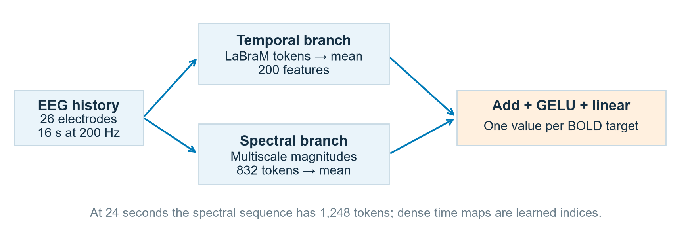

**Speaker notes**
Trace [B,26,3200] through [B,26,16,200]. The temporal branch has 416 data tokens plus CLS, while the spectral branch has 832 tokens at 16 seconds. STFT magnitudes differ from ridge log power. The temporal branch is not explicitly frozen, and pooling after attention does not prove lost order. Source: models/model.py, models/model_multiscale.py; architecture briefing audited at c962c07; NeuroBOLT paper https://arxiv.org/html/2410.05341v2 .

---

## Slide 3. The completed comparison still favours ridge

Historical five-fold temporal r: ridge .381; shared NeuroBOLT 24 s .336; shared NeuroBOLT 16 s .323.

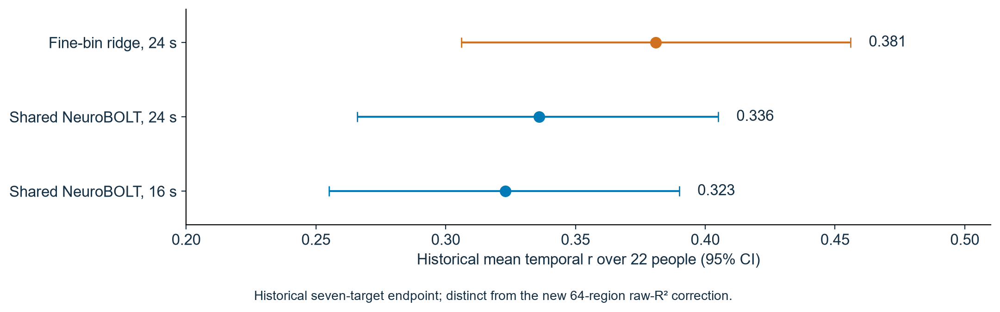

**Speaker notes**
These are historical seven-target correlations and reported confidence intervals from the completed subject-grouped experiment, not reruns in this continuation. Ridge-minus-NeuroBOLT24 was +.045 [+.023,+.067]. The 24-versus16-second gain was +.013 [−.003,+.029]. These outcomes do not establish an irreversible ceiling or universal linearity. Source: reports/NeuroBOLT hypothesis tests.md.

---

## Slide 4. Correlation is not waveform accuracy

The earlier physiology partition used signed squared correlation under an R² label. The correction uses prediction error.

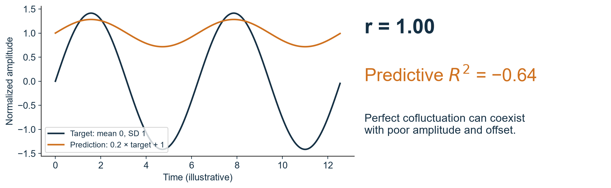

**Speaker notes**
This is an illustrative signal, not participant data: a target with mean zero and SD one, with prediction .2×target+1. Temporal r is 1 while raw predictive R² is -.64. Define R²=1−SSE/SST using the evaluated-run mean for SST; it is a reference, not a model input. No test-fitted rescaling is applied. The former plots also clipped negative partition bars. Keep both historical outputs and explicitly labelled corrections.

---

## Slide 5. People are the units of uncertainty

EEG: R² 0.094 ± 0.094; physiology 0.044 ± 0.049; joint 0.092 ± 0.096.

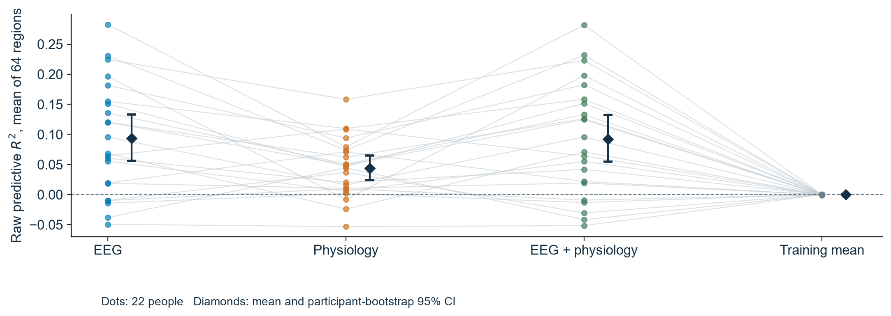

**Speaker notes**
These are means ± SD across 22 people, each first averaged across 64 ROIs and their scans. Error bars are participant bootstrap 95% intervals, not SD. Primary contrast EEG−physiology: +0.0497 (95% CI +0.0185 to +0.0828); p=0.0063, BH=0.0126, BY=0.0189, d_z=0.639. Joint−EEG: -0.0011 (95% CI -0.0040 to +0.0011); p=0.4611, BH=0.4611, BY=0.6916, d_z=-0.179. Intervals and sign flips are exploratory/conditional because folds share training data and prior results influenced development. The two primary contrasts form one FDR family; BH and BY are both reported. ANOVA was not needed for these paired questions. The supplementary figures/physiology_scores.svg shows the signed predictive-score partition, preserving negative estimates. It is not causal variance attribution.

---

## Slide 6. Global-signal regression defines another target

For existing residual-trained ridge, mean regional r=0.144, raw R²=0.010. GSR is retrospective.

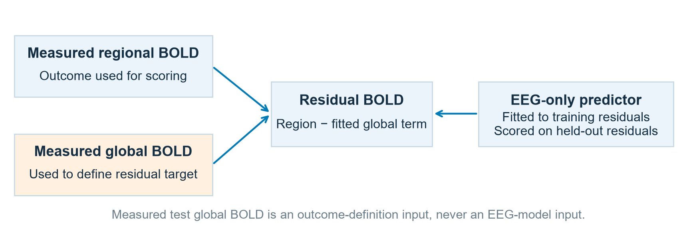

**Speaker notes**
Measured global BOLD defines the residual target but never enters the EEG feature function. Existing models were fitted to residual targets within their historical training/validation protocol; this is different from scoring a raw-trained neural model against residuals. Raw-score and residual-score tables are separate. Circular-shift null at 63 seconds: 28/29 raw7 scans meet BH .05 and 27/29 meet BY .05; repeated scans are not new people. The 126-second sensitivity gives the same rejection counts, but training alpha autocorrelation can remain high (up to .56 at 63 seconds and .45 at126 seconds). Cyclic stationarity remains an assumption; temporal alignment does not rule out shared arousal or physiology. Across-region rho=.65 remains descriptive without a spatially valid null. Whole-run filtering and GSR do not establish online or neuronal specificity.

---

## Slide 7. Lag patterns need participant uncertainty

Alpha peak difference, thalamus minus cortex: -6 s; bootstrap interval [-8, -4] s. Resolution: 2 s.

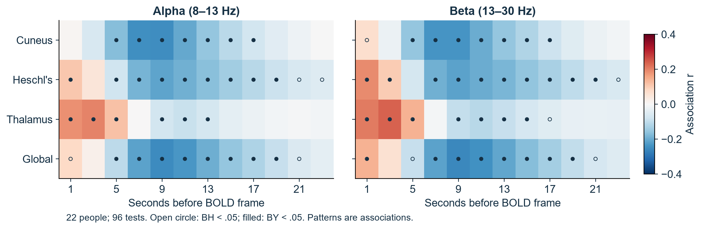

**Speaker notes**
Each scan yields band–lag associations, Fisher transformed and averaged within person before 22-person inference. This is a prespecified exploratory 96-cell family, not thousands of independent samples. BY is a dependence sensitivity, and bootstrap lag curves are in figures/lag_uncertainty.svg. Peaks are selected functionals with discrete/multimodal uncertainty. The previous rank-one penalty was chosen from outer scores, so its fitted kernels cannot provide independent HRF confirmation. Scalp mixing, temporal filtering and arousal can all contribute; a lag is not an identified vascular mechanism.

---

## Slide 8. The checkpoint gate limits neural claims

CKA/IG were blocked by missing CV checkpoints. Existing waveform swaps below remain descriptive evidence from five people.

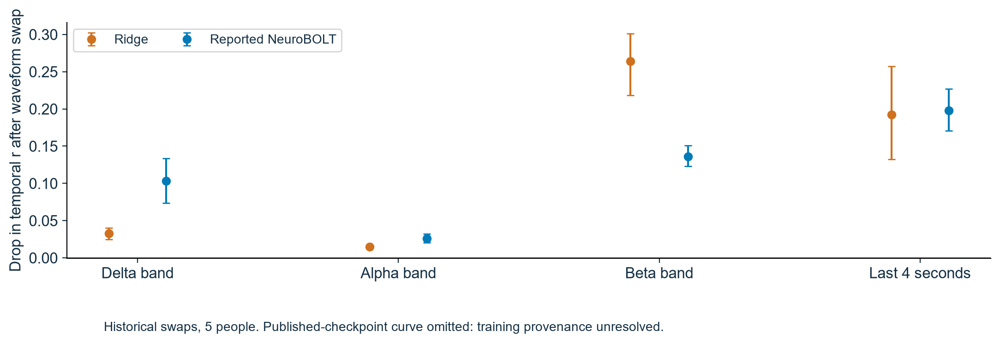

**Speaker notes**
The figure reweights historical waveform swaps across repeats and ROIs, then scans, then five people. With five people a two-sided exact sign-flip test has only 32 sign patterns and minimum p=.0625. It is descriptive reliance evidence, not a high-power causal test. Band widths differ and swapped segments can introduce boundary artifacts. The published-checkpoint curve is omitted for provenance, not its scores: published Thalamus is byte-identical to the standalone intra-scan checkpoint. All original three-model results and their complete 123-test correction remain in attribution_summary.csv. Neither published per-region checkpoints nor the intra-scan Thalamus checkpoint satisfies the requested complete-CV gate. If future checkpoints are saved, verify provenance, baseline predictions, gradient checks and IG completeness; CKA needs centered matched rows, rank/variance checks and shifted/randomized controls.

---

## Slide 9. Next test: physical spectral-lag alignment

Replace one dense time-axis mapping in spectral-only NeuroBOLT24 with physical support-overlap weights.

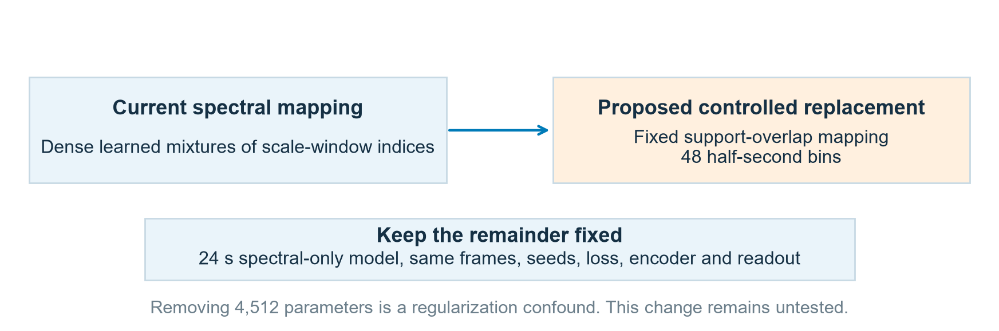

**Speaker notes**
Keep STFT magnitude, frequency projections, scale sum, embeddings, encoder, mean readout and MSE fixed. Compare against an unchanged spectral-only model and fine-bin ridge using identical frames, folds, seeds and selection. Four fixed maps remove 4,512 parameters: a gain could reflect regularization. The falsifier is no validation error benefit or higher r with worse raw R²/amplitude, absent meaningful efficiency gain. This H1 was not executed here. Later ROI queries are inspired by MARBLE, while UnEBOLT uses ROI-conditioned pooled features and UniEFS uses fMRI representation priors; these distinct approaches are not cross-paper leaderboard comparisons.

---

## Slide 10. A two-week investigation with a stopping rule

Complete one controlled change and explain its result. Expand only after a profiled comparison and a new compute budget.

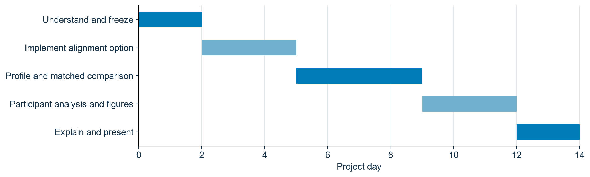

**Speaker notes**
Days1–2: trace tensors and reproduce corrected scores; agree on target and checkpoint provenance. Days3–5: default-off H1 mapping and synthetic support checks. Days6–9: profile a matched development comparison; choose folds/seeds and budget before outer scoring. Full five-fold training is not promised within the present allocation. Days10–12: paired participant/error/coverage analysis. Days13–14: present positive or negative results. The student should explain feature provenance, lag support, r versus R² and why overlapping windows are not independent people. EEG collaborators review clocks/filtering; AI collaborators review inductive bias/capacity; statistical collaborators review inference and endpoint choice.

---

## Mathematical and methodological appendix

$$R^2_{\mathrm{pred}}=1-\frac{\sum_t(y_t-\hat y_t)^2}{\sum_t(y_t-\bar y_{\mathrm{eval}})^2}.$$

For paired effects, $d_z=\bar d/s_d$; undefined when the paired SD is zero.

Future CKA, not run here: $\mathrm{CKA}(X,Y)=\|X^\top Y\|_F^2/(\|X^\top X\|_F\|Y^\top Y\|_F)$ for centered matrices.

Future IG check, not run here: $\sum_i IG_i\approx f(x)-f(x_{\mathrm{ref}})$.

- [Haufe et al.: interpretation of linear weights](https://pubmed.ncbi.nlm.nih.gov/24239590/)
- [Integrated Gradients](https://proceedings.mlr.press/v70/sundararajan17a.html)
- [Saliency sanity checks](https://papers.nips.cc/paper_files/paper/2018/hash/294a8ed24b1ad22ec2e7efea049b8737-Abstract.html)
- [CKA](https://proceedings.mlr.press/v97/kornblith19a.html)
- [FDR, BH and BY](https://docs.scipy.org/doc/scipy-1.13.1/reference/generated/scipy.stats.false_discovery_control.html)

## Limitations

No new models were trained. Saved predictions and features reuse development people; inference conditions on the fitted models and shared training sets. Circular shifts assume stationarity; training alpha autocorrelation remains substantial in some scans even at 126 seconds. Filtered scalp EEG cannot uniquely identify neural/vascular sources. Physiology-focused leads are not guaranteed EEG-free. Existing checkpoints fail the requested complete-CV gate. No clinical, online, individual-connectivity or external-cohort validation is established.

### Supplementary figures

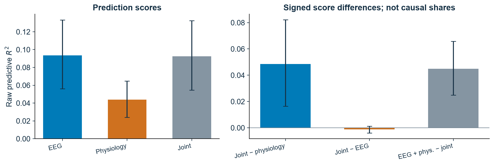

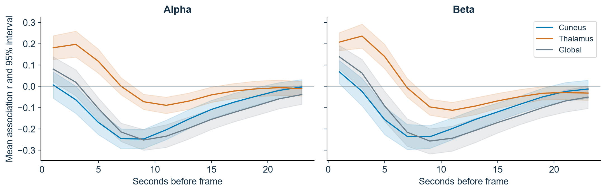
